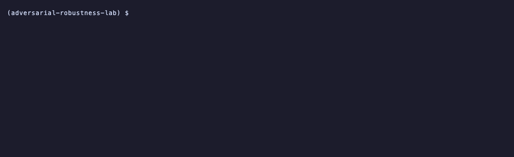
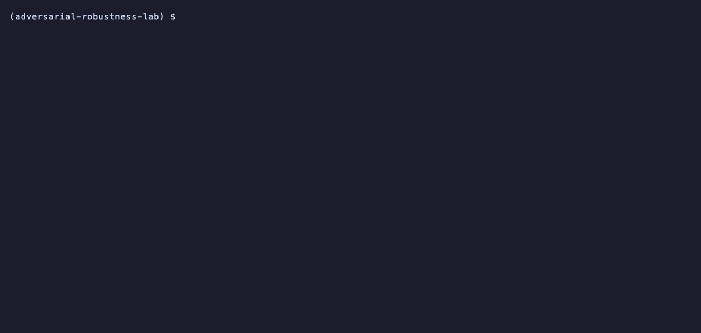
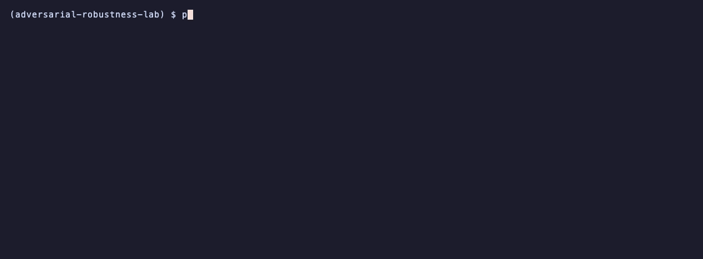

<h1 align="center">Adversarial Robustness Lab</h1>

<p align="center">
  <em>Evasion attacks, adversarial training and randomized smoothing certification for CIFAR-10 classifiers, measured on the full test set.</em>
</p>

<p align="center">
  <a href="https://github.com/adeoluo/adversarial-robustness-lab/actions/workflows/ci.yml"></a>
  <a href="https://github.com/adeoluo/adversarial-robustness-lab/releases"></a>
  
  <a href="LICENSE"></a>
</p>

---

## Motivation

A robustness claim is only as good as the strongest attack it was tested against. Many
published defenses looked robust under PGD and fell to a stronger or adaptive attack,
usually because their gradients were masked rather than because the model was robust.
This repository implements the standard evaluation toolkit in one place and holds it to
the same bar a reviewer would: every attack is checked against a reference library on
the same models, every adversarial batch is verified to lie inside the threat set, and
gradient-masking checks run next to the robust accuracy numbers.

It covers the three sides of the problem on CIFAR-10: attacks (FGSM, PGD in L-infinity
and L2, Carlini-Wagner, APGD-CE, APGD-DLR, APGD-T, Square and an AutoAttack-style
ensemble), defenses by adversarial training (PGD-AT and TRADES, with fast FGSM training
as a baseline), and certified robustness by randomized smoothing (Cohen et al., 2019,
with exact Clopper-Pearson bounds). All models are trained here on an 8 GB Apple M1,
and the training times are reported with the accuracies.

## Architecture

<p align="center">
  
</p>

<sub>Legend: amber = entry points and external systems, indigo = core logic, green = data and state, blue = validation and control, grey = observability and outputs.</sub>

The CLI and the HTTP service pass images and budgets (eps, norm, steps, queries) to the
attack layer, where every attack is built on one set of projections onto the L-infinity
or L2 ball and the pixel box. Models come from the training layer (standard, PGD-AT,
TRADES, fast FGSM, Gaussian noise for smoothing) trained on the 50,000 CIFAR-10
training images; all of them take pixels in [0, 1] and normalize inside the network,
so eps is always in pixel units. The ensemble runs APGD-CE, APGD-T and Square in turn
on the images still robust and keeps the worst case per image. Every adversarial batch
passes a threat-model check before it is scored, and the masking checks and reports
read the per-image outcomes. Module by module walkthrough: [docs/ARCHITECTURE.md](docs/ARCHITECTURE.md).

## Results

All numbers below are from runs on an Apple M1 (8 cores, 8 GB unified memory, PyTorch
MPS backend, shared with other jobs), on CIFAR-10: 50,000 training images and the full
10,000-image test set unless a table says otherwise. Every model is trained here with
seed 0; intervals are 95% Wilson intervals over test images. Raw outputs are in
[`benchmarks/results/`](benchmarks/results/), `make report` prints every table, and
[docs/EVALUATION_REPORT.md](docs/EVALUATION_REPORT.md) has the full method and the
threats to validity.

**Clean and robust accuracy, L-infinity eps = 8/255, all 10,000 test images**

| Model | Training | Parameters | Epochs | Training time | Clean | FGSM | PGD-20 | Ensemble (95% CI) |
|---|---|---:|---:|---:|---:|---:|---:|---|
| WRN-16-2 | standard | 0.69 M | 10 | 18 min | 88.7% | 4.4% | 0.0% | **0.0%** (0.0% to 0.0%) |
| WRN-16-2 | PGD-AT (5 steps) | 0.69 M | 10 | 49 min | 70.7% | 43.0% | 39.1% | **35.5%** (34.6% to 36.4%) |
| WRN-16-2 | TRADES (beta 6) | 0.69 M | 10 | 84 min | 70.5% | 42.6% | 39.8% | **35.4%** (34.5% to 36.4%) |

The ensemble runs APGD-CE (100 steps), APGD-T (3 target classes) and Square (1,000
queries) in turn on the images still correctly classified and reports the per-image worst
case. On both robust models Square found no image the two white-box attacks had missed,
and APGD-CE plus APGD-T is 3.6 to 4.4 points below PGD-20, which is the gap the ensemble
exists to close. TRADES and PGD-AT end within 0.1 points of each other (overlapping
intervals); TRADES took 1.7 times as long to train. For reference, the published TRADES
WideResNet-34-10 (about 46 M parameters, 100 epochs) is listed at 53.1% under AutoAttack
on RobustBench (Croce et al., 2021); that number was quoted, not rerun.

| Model | Clean | After APGD-CE | After APGD-T | After Square | Time (APGD-CE / APGD-T / Square) |
|---|---:|---:|---:|---:|---|
| WRN-16-2 standard | 88.67% | 0.00% | 0.00% | 0.00% | 1794 s / 0 s / 0 s |
| WRN-16-2 PGD-AT (5 steps) | 70.66% | 38.54% | 35.50% | 35.50% | 1852 s / 1199 s / 1168 s |
| WRN-16-2 TRADES (beta 6) | 70.54% | 39.52% | 35.42% | 35.42% | 2760 s / 1746 s / 1788 s |

**Certified L2 accuracy by randomized smoothing** (Cohen et al., 2019; n0 = 100,
n = 10,000 Monte Carlo samples, alpha = 0.001, every 20th test image, 500 images; the
Cohen et al. rows are quoted from their Table 3 (appendix E) for ResNet-110 with n = 100,000 on all
10,000 images and were not rerun)

| Base model | sigma | Images | n | r = 0.00 | r = 0.25 | r = 0.50 | r = 0.75 | r = 1.00 | Abstain |
|---|---:|---:|---:|---:|---:|---:|---:|---:|---:|
| WRN-16-2, noise 0.25 | 0.25 | 500 | 10,000 | 71.4% | 56.2% | 38.2% | 18.2% | 0.0% | 9.6% |
| WRN-16-2, noise 0.5 | 0.5 | 500 | 10,000 | 59.0% | 50.0% | 38.4% | 29.0% | 18.0% | 18.6% |
| Cohen et al. ResNet-110 (cited) | 0.25 | 10,000 | 100,000 | 77% | 61% | 42% | 25% | 0% | n/a |
| Cohen et al. ResNet-110 (cited) | 0.5 | 10,000 | 100,000 | 66% | 55% | 43% | 32% | 22% | n/a |

The smoothed WideResNet-16-2 (0.69 M parameters, 10 epochs) is 3 to 7 points below the
cited ResNet-110 (about 1.7 M parameters) at every radius in the table. With
n = 10,000 the Clopper-Pearson bound caps the certifiable radius at about 0.80 for
sigma 0.25 and 1.6 for sigma 0.50, so the zero at r = 1.00 (sigma 0.25) is a property of
the sampling budget, not only of the model. The full curves at n = 100, 1,000 and 10,000
are in the [evaluation report](docs/EVALUATION_REPORT.md#sampling-budget).

**Attack strength against torchattacks** (3.5.1) on the PGD-trained WideResNet-16-2, same
budgets, same images, same model. A lower robust accuracy means a stronger attack;
the verdict is the exact two-sided sign test on the images only one library broke.

| Attack | Images | Ours: robust acc | torchattacks: robust acc | Broken only by ours / only by torchattacks | Verdict | Time ours / torchattacks |
|---|---:|---:|---:|---:|---|---:|
| FGSM | 10,000 | 43.02% | 43.02% | 0 / 0 | tie (identical outcomes) | 20 s / 15 s |
| PGD-20 | 10,000 | 39.11% | 39.05% | 13 / 19 | tie (p = 0.38) | 153 s / 141 s |
| PGD-L2-20 | 10,000 | 53.24% | 53.01% | 1 / 24 | torchattacks stronger | 192 s / 174 s |
| C&W-L2 (c=1, 100 steps) | 1,000 | 51.90% | 51.90% | 0 / 0 | tie (identical outcomes) | 128 s / 113 s |
| APGD-CE-100 | 1,000 | 40.20% | 40.20% | 0 / 0 | tie (identical outcomes) | 86 s / 73 s |
| APGD-DLR-100 | 1,000 | 39.30% | 39.30% | 0 / 0 | tie (identical outcomes) | 101 s / 107 s |
| Square-1000 | 1,000 | 47.00% | 46.70% | 3 / 6 | tie (p = 0.51) | 420 s / 367 s |
| AutoAttack standard | 500 | 36.80% | 36.80% | 0 / 0 | tie (identical outcomes) | 1019 s / 1039 s |

Seven of eight pairs are ties: FGSM, C&W, both APGD losses and the ensemble agree image
for image, and PGD-20 and Square differ on 32 and 9 images without a significant direction.
torchattacks' PGD-L2 is stronger (24 images against 1, 0.23 points): the two differ in the random start, which here is
uniform over the volume of the L2 ball (so almost always on its surface in 3,072
dimensions) and in torchattacks is a random direction at a uniformly drawn radius. That is
the likely cause; it was not isolated with an ablation. Ours is 8 to 35% slower on six
pairs and slightly faster on APGD-DLR and the ensemble. The
AutoAttack row compares our APGD-CE, APGD-T (9 targets) and Square (5,000 queries)
sequence with the full torchattacks AutoAttack, which also runs FAB-T.

**Gradient-masking checks** (first 1,000 test images, L-infinity 8/255). The three
adversarially trained models pass all eight checks. The same PGD-AT model behind 3-bit
input quantization, a defense whose gradients are zero almost everywhere, looks robust
to PGD and fails four checks; straight-through gradients (BPDA) then remove the apparent
robustness.

| Model | Checks passed | Failed checks | PGD-20 | PGD-20 with BPDA | Square-1000 |
|---|---:|---|---:|---:|---:|
| WRN-16-2 PGD-AT | 8 / 8 | none | 40.7% | n/a | 47.0% |
| WRN-16-2 TRADES | 8 / 8 | none | 40.8% | n/a | 45.7% |
| WRN-16-2 FGSM-RS | 8 / 8 | none | 40.4% | n/a | 47.4% |
| PGD-AT + 3-bit quantization | 4 / 8 | black box beats white box, unbounded attack fails, all-zero gradients, transfer beats white box | 70.5% | **40.5%** | 43.8% |

Quantization leaves clean accuracy at 71.4% (71.2% without it on these images), so the
jump from 40.7% to 70.5% under PGD-20 is masking, not robustness; Square, which needs no
gradients, already gets it down to 43.8%. FGSM-RS shows no catastrophic overfitting at this schedule (PGD-20 within 0.3 points of
PGD-AT on these images). Per-check details: `make report` or the
[evaluation report](docs/EVALUATION_REPORT.md#sanity-checks).

ABLATION_SECTION

## Quickstart

```bash
git clone https://github.com/adeoluo/adversarial-robustness-lab && cd adversarial-robustness-lab
make setup                       # uv sync with the validation group, pre-commit hooks
make data                        # CIFAR-10 (163 MiB, MD5 checked) to ../.bench-data/adversarial-robustness-lab
uv run python -m adversarial_robustness_lab train --arch wrn_16_2 --method pgd --epochs 10 --out runs/wrn_pgd.pt
uv run python -m adversarial_robustness_lab autoattack -c runs/wrn_pgd.pt --n 1000
```

Or with Docker: `docker compose up --build` serves a checkpoint over HTTP (see
`docker-compose.yml`). `ARL_DEVICE` selects `cpu`, `cuda` or `mps`; the default prefers
CUDA, then Apple MPS, then CPU.

## Usage

### Command line

```bash
python -m adversarial_robustness_lab info                                   # versions, device, attacks
python -m adversarial_robustness_lab evaluate -c model.pt --attacks fgsm pgd apgd-ce --eps 8/255
python -m adversarial_robustness_lab autoattack -c model.pt --version standard --norm linf
python -m adversarial_robustness_lab attack -c model.pt --attack pgd --n 6   # per-image predictions
python -m adversarial_robustness_lab certify -c noise025.pt --n-samples 10000 --skip 20
python -m adversarial_robustness_lab sanity -c model.pt --strict            # gradient-masking checks
```

Every command accepts `--n`, `--start`, `--json` and `--out`; epsilons accept fractions
such as `8/255`.

### Library

```python
from adversarial_robustness_lab.attacks import APGD, PGD, AutoAttackEnsemble
from adversarial_robustness_lab.evaluation import evaluate_attack
from adversarial_robustness_lab.smoothing import Smooth

result = evaluate_attack(model, PGD(8 / 255, 2 / 255, 20), x, y, eps=8 / 255, norm="linf")
print(result.robust_accuracy, result.robust_ci())

ensemble = AutoAttackEnsemble.from_version(8 / 255, "linf", "standard")
worst = ensemble.run(model, x, y)  # robust mask and which attack broke each image

cert = Smooth(model, num_classes=10, sigma=0.25).certify(x[0], n0=100, n=10_000, alpha=0.001)
print(cert.prediction, cert.radius)
```

### HTTP service

```bash
python -m adversarial_robustness_lab serve -c model.pt --port 8000
curl -s localhost:8000/v1/attack -d '{"index": 3, "attack": "apgd-ce", "eps": 0.0314}'
curl -s localhost:8000/v1/certify -d '{"index": 3, "sigma": 0.25, "n": 1000}'
curl -s localhost:8000/metrics
```

Routes: `GET /health`, `GET /ready`, `GET /metrics` (Prometheus text), `POST /v1/predict`,
`POST /v1/attack`, `POST /v1/certify`. Work per request is bounded (steps, queries,
samples and body size).

### Reproducing the benchmarks

| Step | Command | Output |
|---|---|---|
| Train the zoo | `make train-all` (or `make train NAME=wrn16_2_pgd`) | `benchmarks/results/train/` |
| Robust accuracy, full test set | `make evaluation` | `benchmarks/results/robustness/` |
| Against torchattacks | `make compare` | `benchmarks/results/compare/` |
| Certification | `make certify` | `benchmarks/results/certify/` |
| Masking checks, ablations | `make sanity`, `uv run python benchmarks/ablations.py` | `benchmarks/results/sanity/`, `ablations/` |
| Tables in this README | `make report` | stdout |

`scripts/eval_queue.sh` runs every step in order, one at a time; long steps save their
progress and stop after about 35 minutes, and the queue resumes them until they finish.

### Demos

Recorded from real runs with [vhs](https://github.com/charmbracelet/vhs); each tape is in `docs/demo/`.

PGD at 8/255 against the standard and the PGD-trained WideResNet-16-2 on the first six test images.

<p align="center">
  
</p>

Gradient-masking checks flag a defense that quantizes its input; the BPDA attack then breaks it.

<p align="center">
  
</p>

Randomized smoothing certificates (sigma 0.25) with their Clopper-Pearson lower bounds and L2 radii.

<p align="center">
  
</p>

## Design decisions

- **Pixel-space threat model, verified on every batch.** Normalization is the first
  layer of every model and each adversarial batch is checked for the box and the budget
  before scoring. [ADR-0002](docs/adr/0002-pixel-space-threat-model-and-verification.md)
- **Report the worst case over an ensemble.** APGD-CE, APGD-T and Square in sequence on
  the survivors, rather than PGD alone. [ADR-0003](docs/adr/0003-autoattack-style-ensemble.md)
- **Training sized for the machine.** One architecture (WideResNet-16-2) for every
  training method, 10 epochs each, so differences come from the method; times stated.
  [ADR-0004](docs/adr/0004-adversarial-training-budget.md)
- **Exact certification statistics in the package.** Clopper-Pearson via the incomplete
  beta function, tested against SciPy and statsmodels; masking checks next to every
  number. [ADR-0005](docs/adr/0005-exact-certification-statistics.md)
- **PyTorch only, batched.** Attacks are tensor programs on the model's device; a
  compiled extension would not help when the cost is the network's forward and backward
  passes. [ADR-0006](docs/adr/0006-pytorch-without-compiled-core.md)

## Testing

```bash
make test           # 231 tests, about 45 s on CPU
make coverage       # with the 80% gate (currently 99% line coverage)
make validation     # the parity group alone: torchattacks, SciPy, statsmodels
```

- **Parity with reference implementations** (53 tests): FGSM, PGD, PGD-L2, C&W, APGD
  and Square against torchattacks on the same seeded models; Clopper-Pearson, the
  incomplete beta, binomial test and normal quantile against SciPy and statsmodels.
- **Property-based tests** (Hypothesis): projections onto the balls and the box, the
  attack losses, seeded batching and the interval statistics on generated inputs.
- **Attack invariants**: every attack stays in its threat set and is deterministic for
  a seed; FGSM matches its closed form on a linear model; restarts are never worse; PGD
  is at least as strong as FGSM and APGD at least as strong as PGD; Square uses no
  gradients; the ensemble's worst case is no better than any member.
- **Training**: each method reduces its loss, checkpoints round-trip, a resumed run
  matches the schedule of a single run.
- **Integration**: every CLI command and HTTP route on a synthetic split, including
  malformed and oversized requests.

CI runs lint, mypy, the tests with the coverage gate on Python 3.11 and 3.12, and builds
the package and the Docker image; CodeQL runs on main and weekly.

## Responsible AI

- **Model card:** [docs/MODEL_CARD.md](docs/MODEL_CARD.md)
- **Data card:** [docs/DATA_CARD.md](docs/DATA_CARD.md)
- **Threat model:** [docs/THREAT_MODEL.md](docs/THREAT_MODEL.md)
- **Evaluation report:** [docs/EVALUATION_REPORT.md](docs/EVALUATION_REPORT.md)

The attacks here are published, widely available techniques for evaluating image
classifiers on a public benchmark; they are meant for measuring defenses, not for
attacking deployed systems. The models are research artifacts for CIFAR-10 and are not
suitable for any real decision.

## Limitations

- **Small models, short schedules.** Every robust model is a 0.69 M parameter
  WideResNet-16-2 trained for 10 epochs, sized for an 8 GB M1. Published PGD-AT and
  TRADES models (WideResNet-34-10, 100+ epochs) are far more robust; their numbers are
  cited, not rerun.
- **One training seed per model.** Intervals cover test-set sampling, not training
  variance; small gaps between training methods may not be significant.
- **Robust accuracy is an upper bound.** The ensemble has APGD-CE, APGD-T and Square but
  not FAB-T; a stronger or adaptive attack could lower the numbers. The sanity checks
  catch common gradient masking, not every failure of the evaluation.
- **Certification at reduced scale.** 500 test images with n = 10,000 samples instead of
  10,000 images with n = 100,000, which caps the certifiable radius (see the sampling
  budget table in the evaluation report).
- **L-infinity first.** The ensemble and adversarial training are evaluated at
  L-infinity 8/255 on the full test set; L2 attacks are compared with torchattacks but
  there is no L2-trained model.
- **No compiled core.** The cost is the network's forward and backward passes, so the
  attacks are batched PyTorch ([ADR-0006](docs/adr/0006-pytorch-without-compiled-core.md)).

## Roadmap

- [ ] FAB-T, to complete the AutoAttack standard sequence.
- [ ] Longer schedules (100+ epochs) and larger WideResNets on a GPU machine.
- [ ] Certification of all 10,000 test images with n = 100,000.
- [ ] L2 adversarial training and the L2 ensemble on the full test set.

## License

Released under the [MIT License](LICENSE).
