# Architecture

The package is a set of small modules around one contract: models take images with
pixels in [0, 1] and return logits, and every attack returns images inside its threat
set. The README diagram shows the layers; this page follows the code paths.

## Modules

| Module | Role |
|---|---|
| `data.py` | Reads the official CIFAR-10 archive (MD5 checked), caches it as uint8 NCHW, on-device crop and flip augmentation, seeded batching, a synthetic stand-in for tests |
| `models.py` | PreAct ResNet-18, WideResNet-d-k, a small CNN; standardization is the first layer |
| `attacks/geometry.py` | Norms, projections onto the L-infinity and L2 balls and the pixel box, random starts, steepest-ascent directions |
| `attacks/losses.py` | Cross-entropy, C&W margin, DLR and targeted DLR, per sample |
| `attacks/pgd.py` | FGSM and PGD (L-infinity, L2, restarts, any loss) |
| `attacks/cw.py` | Carlini-Wagner L2 with tanh reparametrization, Adam and a binary search on c |
| `attacks/apgd.py` | APGD with checkpoints, momentum and step halving; APGD-T over target classes |
| `attacks/square.py` | Square attack (L-infinity), vectorized windows per image |
| `attacks/autoattack.py` | Sequential worst-case ensembles (`standard`, `fast`, `rand`) |
| `training.py` | Standard, PGD-AT, TRADES, FGSM with random start, Gaussian noise; one-cycle or piecewise schedules; per-epoch checkpoints and resume |
| `smoothing.py` | Cohen et al.'s PREDICT and CERTIFY, certified accuracy |
| `stats.py` | Incomplete beta and its inverse, Clopper-Pearson, exact binomial test, Wilson, bootstrap |
| `evaluation.py` | Batched robust accuracy with a threat-model check on every batch |
| `sanity.py`, `masking.py` | Gradient-masking checks; input quantization and BPDA as a positive control |
| `cli.py`, `service.py` | Command line and the HTTP service |
| `runtime.py` | Device choice (`ARL_DEVICE`), MPS memory cap, seeding, safe checkpoints (`weights_only=True`) |

## An evaluation, step by step

1. `load_cifar10()` returns the 10,000 test images as uint8; `evaluate_attack` converts
   one batch at a time to float on the model's device.
2. Clean predictions are computed first. Misclassified images count as non-robust and
   are not attacked.
3. The attack runs on the correctly classified images. For PGD each step is one forward
   and one backward pass, a normalized step, and `project_to_threat`.
4. `check_threat_model` verifies the batch (finite, in [0, 1], within eps); then the
   adversarial predictions are scored.
5. The ensemble repeats steps 3 and 4 with APGD-CE, APGD-T and Square, each on the
   images still robust, and records which attack broke each image.
6. Per-image outcomes are saved (`benchmarks/results/robustness/*.npz`), so intervals,
   overlaps between attacks and any new aggregate can be recomputed without the GPU.

## A certificate, step by step

  

Legend: amber = entry points and external systems, indigo = core logic, green = data and state, blue = validation and control, grey = observability and outputs.

Selection and estimation use separate samples, as in the paper, so the bound is valid
for the selected class. The benchmark draws the estimation samples in nested blocks and
records the count after 100, 1,000 and 10,000 samples, which gives the effect of the
Monte Carlo budget from one run.

## Adversarial training

`training_loss` returns the batch loss for the configured method. PGD-AT calls
`PGD._run` (random start, fixed step) on the augmented batch in train mode, then takes
the cross-entropy on the result. TRADES switches to eval mode for its KL inner
maximization, back to train mode, and adds beta times the KL term to the clean
cross-entropy. The per-epoch monitor reports clean accuracy on 1,000 test images and
PGD-10 accuracy on 500 (never used for model selection: the last epoch is evaluated).
